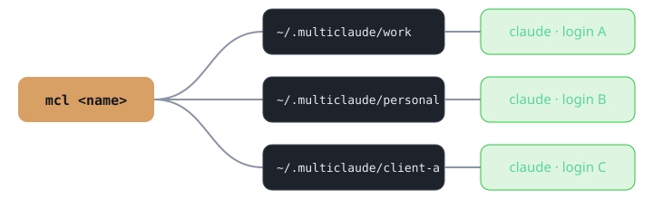

<h1 align="center">mcl · multiclaude</h1>
<p align="center"><b>Run multiple Claude Code logins side by side.</b><br>
Work, personal, clients — each with its own account, history and settings. One command.</p>

<p align="center"><a href="https://al-mo.de/tools/mcl/">Website</a></p>

<p align="center"></p>

## Why

Claude Code keeps one login per config directory. Switching accounts means logging out and
back in, losing context every time. `mcl` gives every account its own isolated directory
(via `CLAUDE_CONFIG_DIR`) and launches `claude` inside it. Run two accounts in two terminals at once.

<p align="center"></p>

## Install

```
uv tool install git+https://github.com/mkalmousli/multiclaude
# or from a clone:  uv tool install .
```

Update: `uv tool install --reinstall .` · Remove: `uv tool uninstall multiclaude`

## Use

```
mcl work                 # start claude as instance "work" (log in on first run)
mcl personal -c          # any claude args pass through
mcl work -p "hi"

mcl ls                   # list instances, accounts, last used
mcl new client --share   # new instance that shares settings, CLAUDE.md, commands, agents, skills
mcl mv client acme       # rename
mcl rm acme              # delete (asks first; -y to skip)
mcl path work            # print config dir
mcl run ls               # run an instance whose name clashes with a command
```

`--share` symlinks your shared config from `~/.claude` (or `--share=DIR`) while keeping
logins and history separate.

## Configuration

| Variable | Purpose |
|---|---|
| `MULTICLAUDE_HOME` | Where instances live (default `~/.multiclaude`) |
| `MULTICLAUDE_CLAUDE` | Path to a specific `claude` binary |

## Layout

- `instances.py` – naming, storage, listing
- `runner.py` – `build_env()` is the place to add per-instance env/settings
- `cli.py` – commands

MIT licensed. Zero dependencies. Python ≥ 3.9. Works on Linux, macOS and Windows (on Windows, `--share` copies instead of symlinking when symlinks are not permitted).
